<p align="center">
  
</p>

<h1 align="center">FileSwitch 交换站</h1>

<p align="center">
  在自己的几台设备之间，私密地交换文件。<br>
  服务端跑在 NAS 的 Docker 里 · 客户端覆盖 macOS / Windows / Android / iOS · 不用 SMB
</p>

<p align="center">
  
  
  
  
  
  
</p>

<p align="center">
  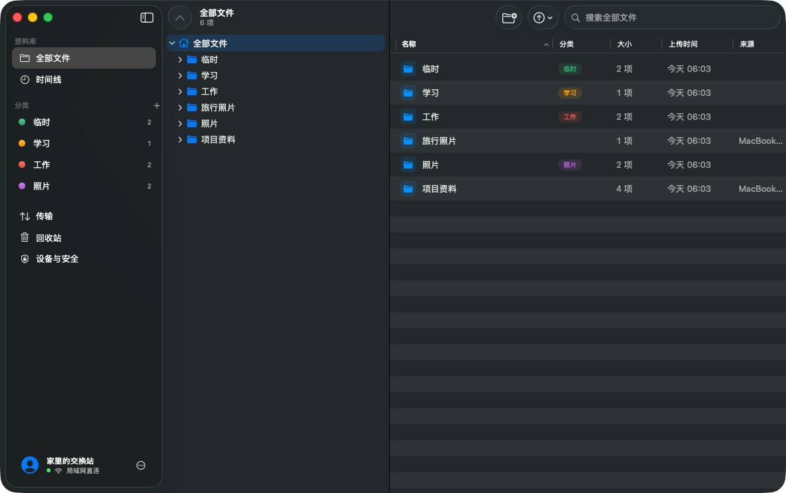
</p>

## 它能做什么

- **拖到菜单栏就上传**：macOS 上把文件或文件夹拖到右上角菜单栏图标附近，会弹出投递面板；面板上是你自己定义的分类，拖到某个分类上松手就开始上传。
- **常驻托盘**：macOS 菜单栏、Windows 系统托盘常驻；Windows 另有贴在右下角的「迷你投递窗」。
- **原生 Apple 客户端**：macOS 和 iOS 是 SwiftUI 原生应用，采用 macOS 26 / iOS 26 的 Liquid Glass 设计（悬浮的玻璃侧边栏、玻璃投递面板、可收起的玻璃标签栏）。iPad 上和 Mac 一样是侧边栏 + 文件树 + 多列表格，可以从「文件」等 App 把文件拖到分类上上传；分屏或侧拉成窄窗口时自动换成手机布局。Android 和 Windows 使用 Flutter 客户端。
- **像共享文件夹一样管理**：文件树、面包屑、搜索、拖拽移动、多选、回收站；文件可以归类，也能按时间线回看每一次投递。
- **私密、安全**：只开一个 HTTPS 端口；TLS 1.3 + 证书指纹固定；Argon2id 密码 + 每台设备独立令牌（可随时撤销）；文件在 NAS 磁盘上加密存储。
- **出门也能用，但 NAS 不暴露到公网**（可选）：借一台有公网 IP 的服务器做中转站和缓存。NAS 不做端口映射，而是按自己的节奏**主动**去中转站取件；中转站上只有端到端加密的密文，被攻破也读不到任何东西。在家自动直连，出门自动走中转。

## 截图

### 拖到菜单栏，按分类投递

<table>
  <tr>
    <td width="36%" align="center">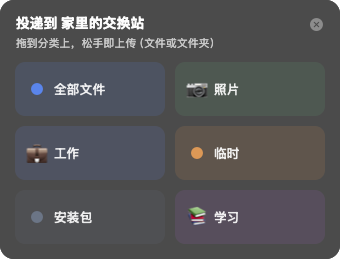<br><sub>拖动文件靠近菜单栏图标时自动弹出的 Liquid Glass 面板</sub></td>
    <td align="center">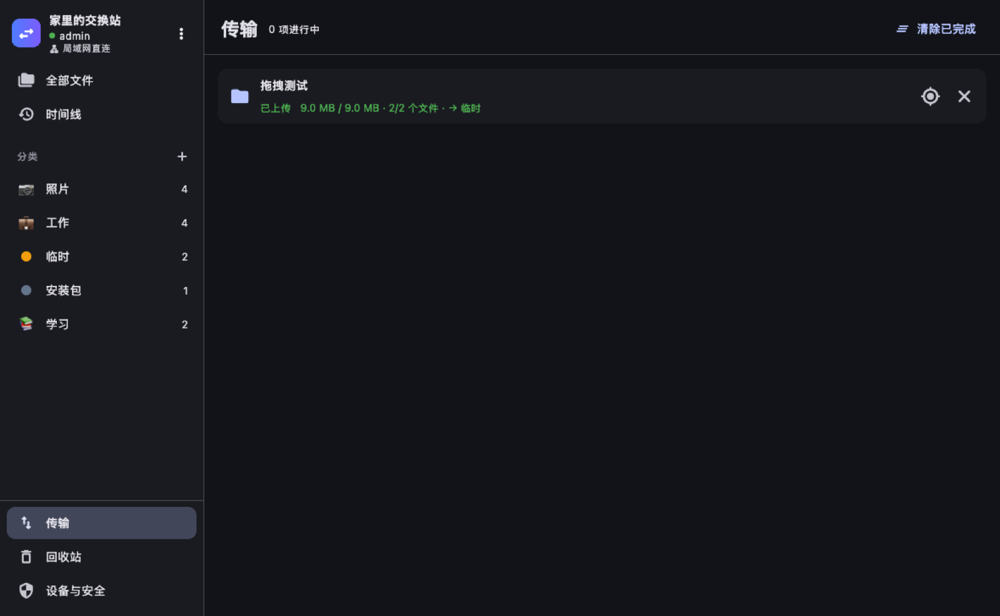<br><sub>文件夹完整保留目录结构，大文件分块上传、断网续传</sub></td>
  </tr>
</table>

### 文件树 · 分类 · 时间线

<table>
  <tr>
    <td align="center">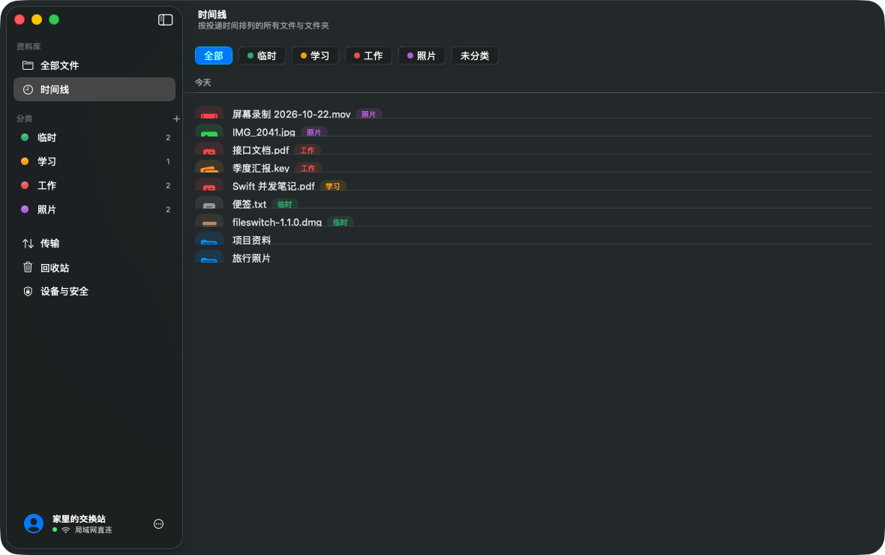<br><sub>时间线：按投递时间回看，可按分类筛选，显示来源设备</sub></td>
    <td align="center">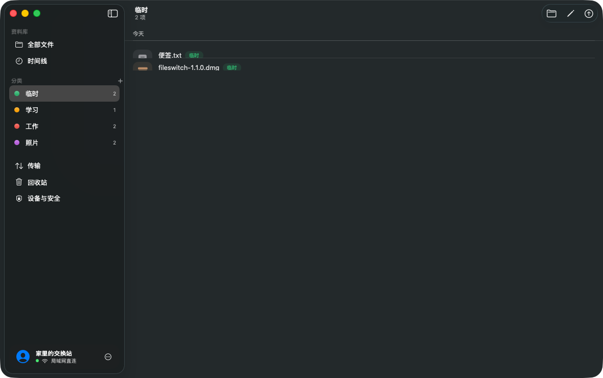<br><sub>分类：拖到侧边栏的分类上即投递；文件也能单独打分类</sub></td>
  </tr>
</table>

### 连接 · iPad · 手机端

<p align="center">
  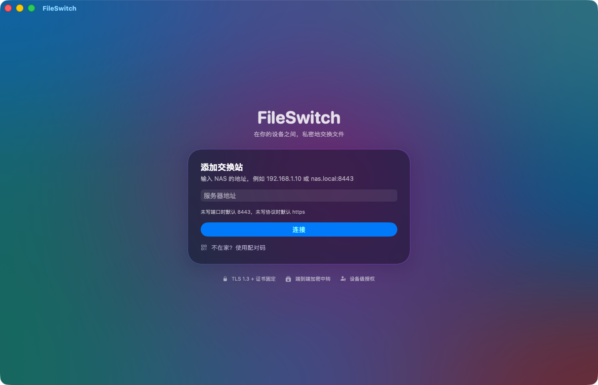
</p>

<p align="center">
  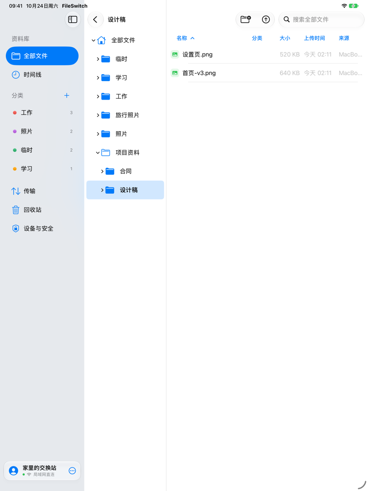
</p>

<p align="center">
  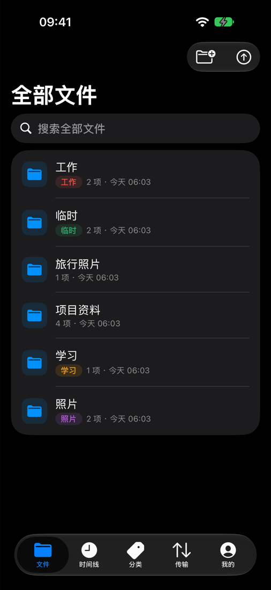
  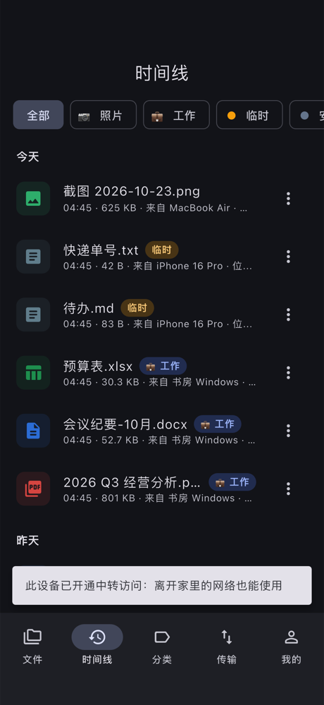
  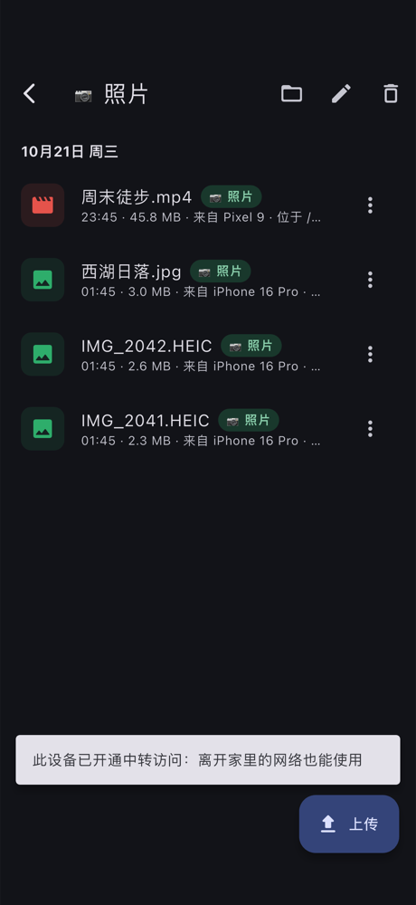
  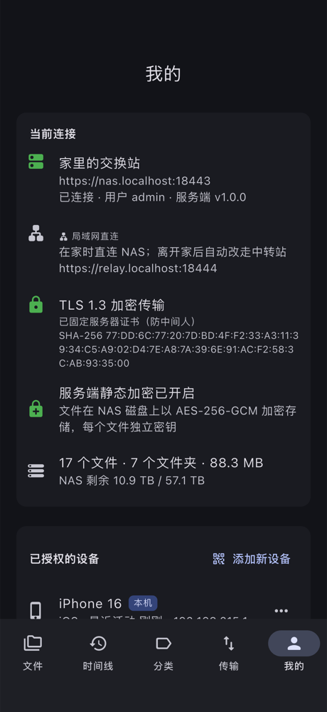
</p>

<p align="center"><sub>以上为 macOS / iOS 原生客户端。</sub></p>

### 出门在外：经中转站

<sub>以下截图来自 Flutter 客户端（Android / Windows 使用），原生客户端的流程相同。</sub>

<table>
  <tr>
    <td align="center">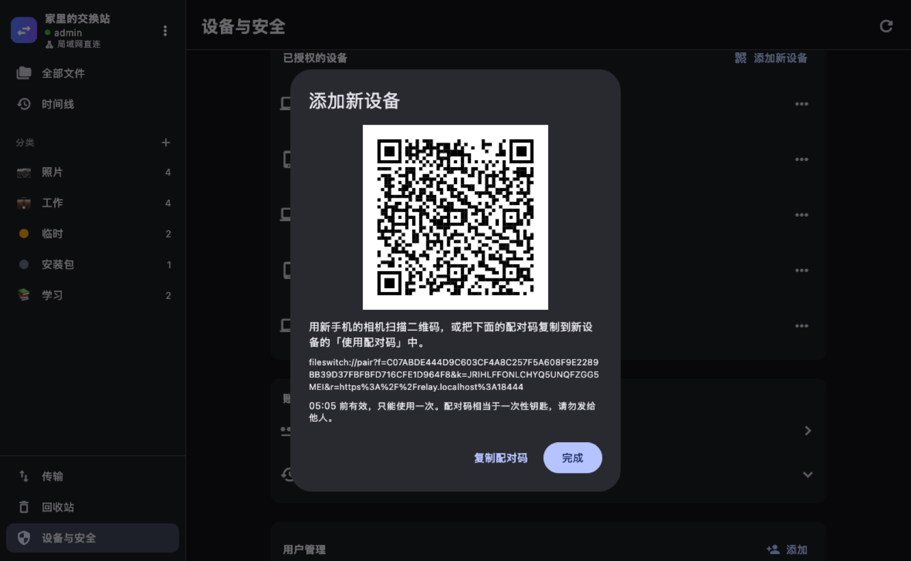<br><sub>在已登录设备上生成一次性配对码，手机用相机扫码即可加入</sub></td>
    <td align="center">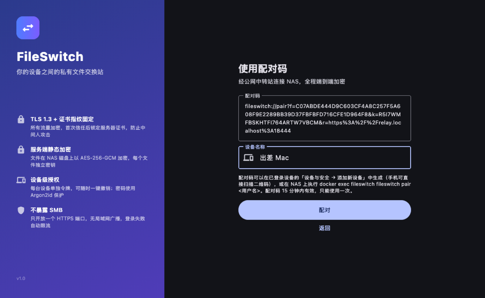<br><sub>新设备粘贴配对码，NAS 下次同步时确认</sub></td>
  </tr>
  <tr>
    <td align="center">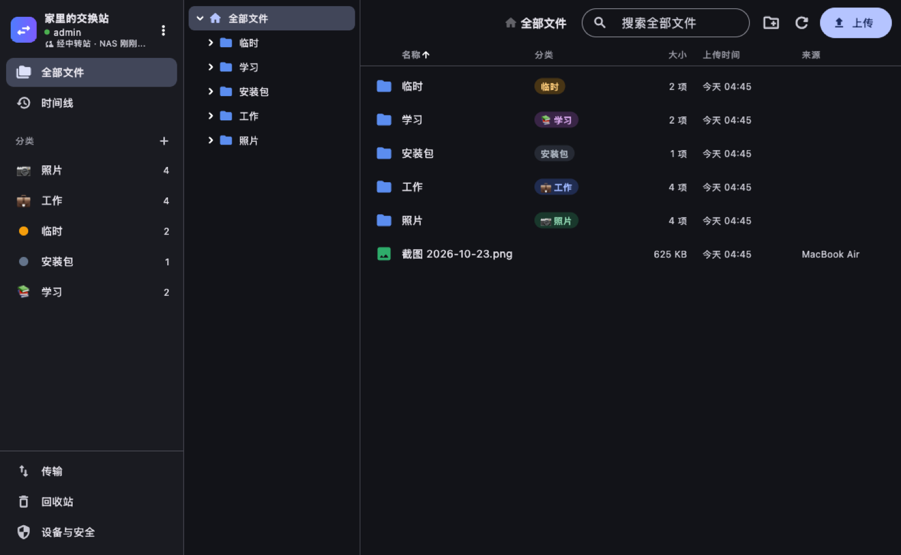<br><sub>侧边栏显示「经中转站」；浏览、搜索、时间线都是即时的</sub></td>
    <td align="center">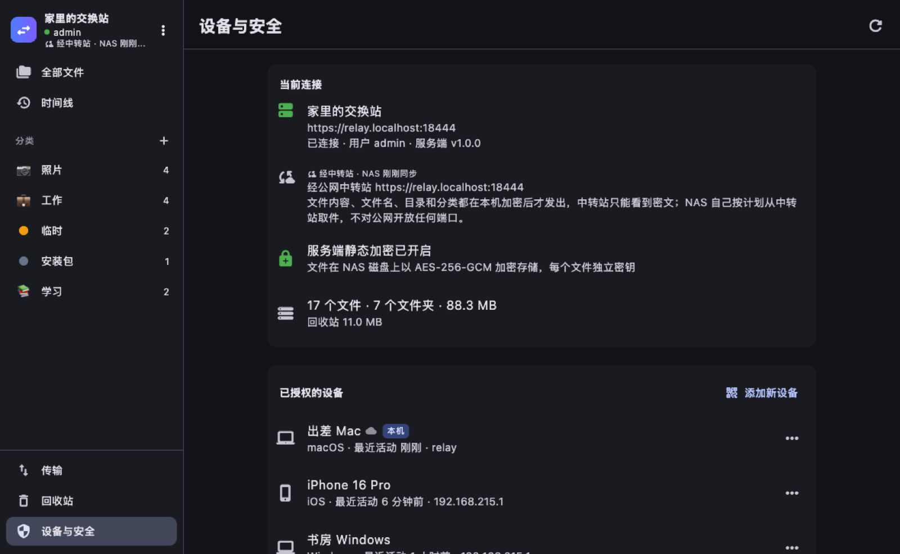<br><sub>中转站只能看到密文；修改密码等敏感操作仅限局域网</sub></td>
  </tr>
</table>

## 架构

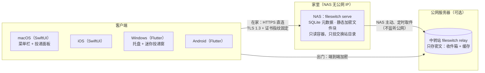

一次「出门时上传」是这样走的：

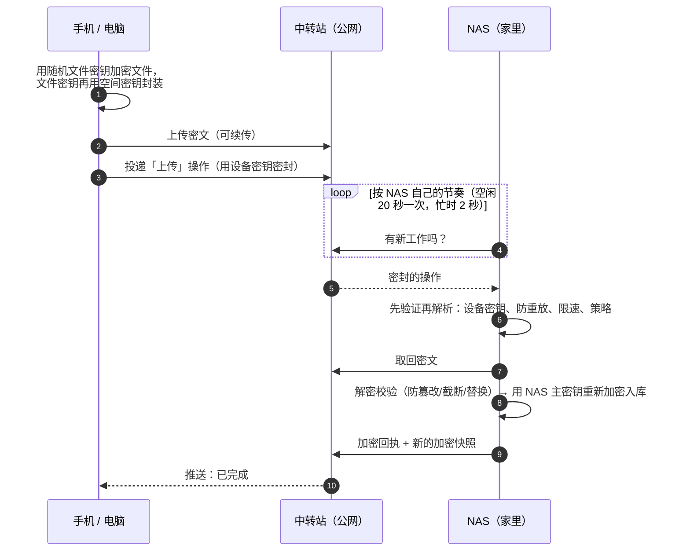

## 安全

### 和 SMB 比

| | SMB 共享 | FileSwitch |
|---|---|---|
| 传输 | 常见配置不加密；NTLM 可被中继/破解 | 强制 **TLS 1.3**；自签证书首次连接核对指纹后**固定**（类似 SSH），证书被替换会拒绝连接 |
| 暴露面 | 445 端口、局域网广播/发现 | 只有一个 HTTPS 端口，无广播；中转模式下 NAS 可以**一个端口都不开** |
| 认证 | 账号密码直接用于每次连接 | 密码用 **Argon2id** 存储，只在登录时用一次；之后每台设备持有独立的 256 位令牌（服务端只存哈希），可**单独撤销** |
| 暴力破解 | 通常无防护 | 三层限流：同一来源对同一账号连续输错会被逐次加长暂停（最长 15 分钟）；同一来源 15 分钟内最多错 20 次；同一账号被各处累计错 50 次时暂停 15 分钟，挡住分散的猜测，又不至于被人一直锁住。不泄露用户名是否存在 |
| 磁盘上的数据 | 明文 | **静态加密**：每个文件一个随机密钥（AES-256-GCM，64 KiB 分段认证，防篡改/截断），文件密钥再由主密钥加密 |
| 审计 | 有限 | 登录、失败登录（连不存在的账号名也记）、上传、新建、改名、移动、删除、恢复、彻底删除、分类与设备变更都有记录，标明是哪台设备、从哪个 IP；可分页、按动作和关键字筛选，管理员能看全部用户 |
| 多用户 | 共享目录权限 | 每个用户一个完全隔离的空间 |

<p align="center">
  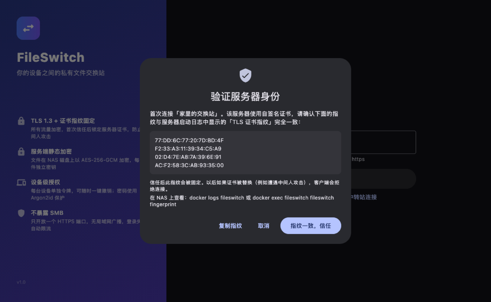<br>
  <sub>首次连接时核对证书指纹，之后被固定：中间人换了证书，客户端会直接拒绝</sub>
</p>

### 中转站被攻破会怎样

| 攻击者拿下了… | 能得到 | 做不到 |
|---|---|---|
| 中转站（root 权限、全部数据） | 密文、文件大小、时间规律；可以丢弃或拖延消息 | 读文件内容、文件名、目录、分类；伪造或重放操作；用别的文件冒名顶替；连进 NAS；接触 NAS 上任何其他数据 |
| 一台外出的已授权设备 | 交换空间里的文件（直到你撤销它） | 远程彻底删除、添加新设备（默认禁止）；改密码、管理用户（只能在局域网做） |

- 所有内容都在客户端或 NAS 上用 **XChaCha20-Poly1305** 加密，密钥从不经过中转站；每台设备的操作用它自己的密钥密封，中转站无法伪造。
- 撤销设备时，中转站立即拒绝它，NAS 同时**轮换加密密钥**，被撤销的设备再也解不开之后的数据。
- NAS 把中转站来的一切当作敌意输入：先验证再解析、严格校验、限速限量、去重防重放；能执行的只有交换空间里的少数几种操作，代码里根本没有「读任意路径」「远程改密码」这样的路径。
- NAS 容器只读运行、去掉全部 Linux capabilities、禁止提权、非 root、只挂载交换站自己的目录：即使有未知漏洞，影响也被限制在交换站的数据里。

自动化测试模拟了恶意中转站（伪造操作、重放、替换文件、越权彻底删除和添加设备），并扫描了中转站存储的全部数据：找不到任何文件名或文件内容。协议细节与完整威胁模型见 [docs/relay-protocol.md](docs/relay-protocol.md)。

<p align="center">
  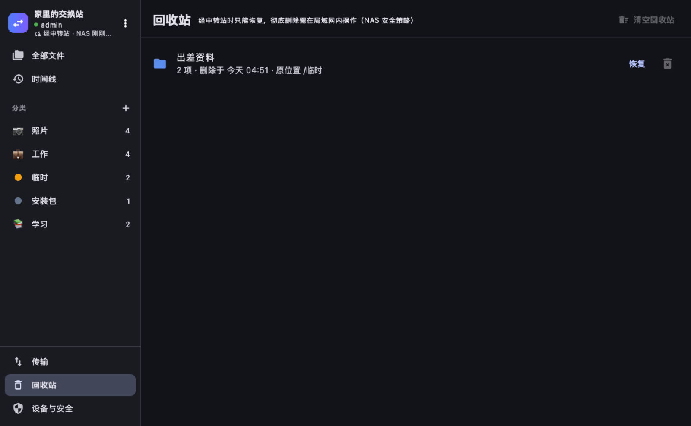<br>
  <sub>经中转站时只能删到回收站；彻底删除需要回到局域网（NAS 安全策略，可配置）</sub>
</p>

> 关于静态加密：主密钥默认生成在数据卷里（`data/keys/master.key`），能防硬盘被拿走后直接读取文件，但拿到整个数据卷的人仍能解密。若要更强的保护，用 `FS_MASTER_KEY_FILE` 把密钥放在数据卷**之外**（例如另一块盘或 Docker secret）。**主密钥丢失 = 文件无法恢复，请务必备份。**

## 部署

### 一、NAS 端

```bash
git clone https://github.com/TTStick/a-file-relay.git fileswitch
```

```bash
cd fileswitch && docker compose up -d --build
```

```bash
docker compose logs fileswitch
```

首次启动日志里有两样东西要记下来：

```
================ 初始管理员 ================
用户名: admin
密码:   xxxxxxxxxxxxxxxx
============================================
level=INFO msg="TLS 证书指纹 (SHA-256)，客户端首次连接时请核对" fingerprint=F4:1B:65:...
```

- 群晖 Container Manager / 威联通 Container Station / Unraid：用「项目 / Compose」导入 `docker-compose.yml` 即可。
- `user: "1000:1000"` 改成 NAS 上数据目录属主的 uid:gid（群晖 SSH 中执行 `id` 查看）。
- 国内网络构建镜像时，把 compose 里的 `GOPROXY` 改为 `https://goproxy.cn,direct`。
- 镜像支持 amd64 与 arm64：`docker buildx build --platform linux/amd64,linux/arm64 -t fileswitch server/`
- `docker-compose.yml` 已经做了容器加固（只读、无 capabilities、禁止提权、限制进程数和内存），请只挂载交换站自己的数据目录。

### 二、公网中转站（可选：NAS 没有公网 IP 时）

在有公网 IP 的服务器上（同样用 Docker），把仓库克隆下来后：

```bash
cd fileswitch/relay && cp .env.example .env
```

```bash
openssl rand -hex 32
```

把生成的随机串填进 `.env` 的 `FS_RELAY_NAS_TOKEN`，`FS_DOMAIN` 填一个解析到这台服务器的域名（开放 80/443，Caddy 会自动申请 Let's Encrypt 证书）：

```bash
docker compose up -d --build
```

没有域名时改用自签证书版本 `docker compose -f docker-compose.selfsigned.yml up -d --build`，并从它的日志里记下 TLS 指纹。

然后在 **NAS** 的 `docker-compose.yml` 里打开这几行并重启：

```yaml
FS_RELAY_URL: https://relay.example.com
FS_RELAY_TOKEN: <与中转站相同的随机串>
# FS_RELAY_FINGERPRINT: <仅自签证书时填写>
```

NAS 日志出现「中转模式已启用：NAS 只主动连接中转站，不接受任何入站连接」即可。之后：

- 在家登录过的设备会**自动开通**中转访问：出门时自动切换，回家后自动回到直连。
- 不在家的新设备：在已登录设备上「设备与安全 → 添加新设备」生成配对码（手机用相机扫二维码即可），或在 NAS 上执行 `docker exec fileswitch fileswitch pair <用户名>`。经中转站生成配对码默认是禁止的（防止丢失的设备再「复制」出新设备），可用 `FS_REMOTE_PAIRING=true` 放开。
- 最强隔离：设置 `FS_LAN=false` 并删掉 NAS compose 里的 `ports`，NAS 将不监听任何端口，只经中转站访问（此时新设备只能用 NAS 上的 `fileswitch pair` 添加）。

### 配置参考

| 变量 | 默认 | 说明 |
|---|---|---|
| `FS_SERVER_NAME` | `FileSwitch` | 显示在客户端和投递面板上的名字 |
| `FS_LISTEN` | `:8443` | 监听地址 |
| `FS_DATA_DIR` | `/data` | 数据目录（数据库、加密文件块、证书、密钥） |
| `FS_ADMIN_USER` / `FS_ADMIN_PASSWORD` | `admin` / 随机 | 仅首次启动时创建管理员 |
| `FS_TLS` | `auto` | `auto`：自签证书（客户端指纹固定）；`off`：仅当前面有 HTTPS 反向代理时 |
| `FS_TLS_CERT` / `FS_TLS_KEY` | | 使用自己的证书（如 Let's Encrypt），客户端走系统证书校验 |
| `FS_TLS_HOSTS` | | 自签证书额外写入的主机名/IP，逗号分隔 |
| `FS_ENCRYPT` | `true` | 服务端静态加密（中转模式要求开启） |
| `FS_MASTER_KEY` / `FS_MASTER_KEY_FILE` | 自动生成 | 32 字节主密钥（hex 或 base64）或其文件路径 |
| `FS_TRASH_DAYS` | `30` | 回收站自动清理天数，0 = 不清理 |
| `FS_MAX_FILE_SIZE` | `0` | 单文件大小上限（字节），0 = 不限 |
| `FS_USER_QUOTA` | `0` | 每个账号最多占用的空间（含回收站和未完成的上传），如 `500G`；0 = 不限 |
| `FS_TRUST_PROXY` | `false` | 在反向代理后时打开，取 `X-Forwarded-For` 的最后一项做登录限流。只适用于前面恰好一层代理的情况 |
| `FS_LAN` | `true` | 是否在局域网监听；`false` 时 NAS 不开任何端口，只经中转站访问 |
| `FS_RELAY_URL` / `FS_RELAY_TOKEN` | | 中转站地址与 NAS 令牌（与中转站的 `FS_RELAY_NAS_TOKEN` 相同） |
| `FS_RELAY_FINGERPRINT` | | 中转站使用自签证书时的 SHA-256 指纹 |
| `FS_RELAY_INTERVAL` | `20s` | NAS 空闲时多久主动取一次件（有活动后 2 分钟内每 2 秒一次） |
| `FS_RELAY_CACHE_DAYS` / `_MAX_FILE` / `_MAX_TOTAL` | `7` / `256M` / `4G` | 预先把最近的文件加密放到中转站，外出时可以直接下载 |
| `FS_REMOTE_MAX_FILE` | `8G` | 经中转站上传/获取的单文件上限 |
| `FS_REMOTE_PURGE` | `false` | 外出的设备能否彻底删除（默认只能删到回收站） |
| `FS_REMOTE_PAIRING` | `false` | 外出的设备能否生成配对码添加新设备 |

中转站（`fileswitch relay`）另有：`FS_RELAY_NAS_TOKEN`（必填）、`FS_RELAY_QUOTA`（每个交换空间可暂存，NAS 上每个用户一个空间，默认 50G；磁盘按「空间数 × 配额」预留）、`FS_RELAY_MAX_FILE`（默认 16G）、`FS_RELAY_UPLOAD_TTL`（未被收取的上传保留时间，默认 168h）、`FS_RELAY_CACHE_TTL`（缓存保留时间，默认 336h）。

### 运维命令

```bash
docker exec fileswitch fileswitch fingerprint                 # 查看证书指纹
docker exec fileswitch fileswitch user list
docker exec fileswitch fileswitch user add alice              # 不带 --password 会生成随机密码
docker exec fileswitch fileswitch user passwd alice           # 重置密码并让其所有设备下线
docker exec fileswitch fileswitch user admin alice on
docker exec fileswitch fileswitch pair alice                  # 生成一次性配对码（经中转站添加新设备）
docker exec fileswitch fileswitch export alice /data/export   # 解密导出某用户的全部文件（灾备）
```

备份：停容器后备份整个数据目录，并**另外**备份主密钥。升级：`docker compose up -d --build`，证书与指纹保持不变，旧数据会自动迁移。

## 客户端

### 使用

1. 添加服务器：输入 `NAS地址` 或 `NAS地址:端口`（不写端口默认 8443、默认 https）。不在家的新设备选「使用配对码」。
2. 首次连接会弹出证书指纹，与服务端日志里的指纹逐字核对后点「信任」。
3. 用账号登录，并给这台设备起个名字（会显示为文件来源，可在「设备与安全」里撤销）。
4. 在侧边栏「分类」处新建分类（名称、颜色、可选 emoji）。投递到分类的文件会放进根目录下同名的文件夹并打上分类标签；文件也可以在任何位置单独设置分类。
5. 投递方式：
   - macOS：拖到菜单栏图标附近（图标被刘海遮住时，拖到屏幕右上角也可以）→ 面板弹出 → 拖到分类上松手。
   - Windows：托盘右键 →「迷你投递窗」，或直接拖进主窗口。
   - 主窗口：拖到文件列表（上传到当前文件夹）或侧边栏的分类上。
   - 手机：右下角 + 号选择照片/文件（Android 也可选文件夹）。
6. 文件夹会保留完整的目录结构（包括空文件夹），自动忽略 `.DS_Store`、`Thumbs.db` 等垃圾文件；大文件分块上传，断网后自动续传。
7. 「时间线」按投递时间列出每次投递，可按分类筛选；其他设备投递新文件时桌面端会弹通知。
8. 经中转站时，侧边栏显示「经中转站 · NAS x 分钟前同步 · n 项待同步」。浏览、搜索、时间线即时可用；重命名、移动、删除会立刻显示，并在 NAS 下次取件时真正执行（NAS 拒绝时会提示并恢复）；上传先加密传到中转站，等 NAS 收取后完成；最近的文件 NAS 已预先放在中转站上，其他文件下载时会先请 NAS 送过来。

桌面端快捷操作：双击打开、右键菜单、`⌘/Ctrl+A` 全选、`Shift` 连选、`Delete`/`⌘⌫` 删除、`F2` 重命名、把文件拖到文件夹/面包屑/目录树上移动、拖到侧边栏分类上设置分类。

### 构建

#### macOS / iOS 原生客户端（`apple/`）

需要 Xcode 26+，最低系统为 macOS 26 / iOS 26。工程由 [XcodeGen](https://github.com/yonaskolb/XcodeGen) 从 `apple/project.yml` 生成，生成好的 `FileSwitch.xcodeproj` 也一并提交了，可以直接打开。

```bash
sudo xcode-select -s /Applications/Xcode.app/Contents/Developer
```

```bash
cd apple && xcodebuild -project FileSwitch.xcodeproj -scheme FileSwitch-macOS -configuration Release build
```

```bash
xcodebuild -project FileSwitch.xcodeproj -scheme FileSwitch-iOS -sdk iphonesimulator -destination 'generic/platform=iOS Simulator' build
```

iOS 真机需要在 Xcode 的 Signing & Capabilities 中选择开发团队。macOS 版默认是 ad-hoc 签名、未公证，首次打开请右键选择「打开」；正式分发时换成你的 Developer ID。详见 [apple/README.md](apple/README.md)。

#### Android / Windows（Flutter，`client/`）

需要 Flutter 3.47+（项目使用 Swift Package Manager，**不需要 CocoaPods**）。国内网络可先 `source scripts/env.sh` 使用镜像。

```bash
cd client && flutter pub get
```

```bash
flutter build macos --release        # build/macos/Build/Products/Release/FileSwitch.app
```

```bash
flutter build windows --release      # 在 Windows 上执行；build\windows\x64\runner\Release\
```

```bash
flutter build apk --release          # Android
```

Flutter 工程同样能构建 macOS / iOS（`flutter build macos` / `flutter build ipa`），适合 macOS 26 以前的系统；在新系统上推荐使用原生客户端。

macOS 版本未启用 App Sandbox（投递面板需要直接读取被拖入的任意文件），适合 Developer ID 签名后在 App Store 之外分发。开机自启使用 `SMAppService`。

## 开发与测试

```bash
cd server && go test ./...
```

覆盖加密存储（篡改/截断/错误密钥检测）、完整 API、登录限流，以及 NAS ↔ 中转站 ↔ 客户端三方协议（包括恶意中转站）。Go 与 Dart 的加密实现用同一组测试向量互相验证（`client/test/e2e_test.dart`）。原生客户端的 Swift 实现也用这组向量（`client/test/e2e_vectors.json`）核对过，双向互通。

客户端端到端测试驱动真实的 App 对接真实的服务端，每一步都会截图（「经中转站」一节的截图就是这样生成的）：

```bash
cd client && flutter test integration_test/app_test.dart -d macos --dart-define=FS_TEST_URL=127.0.0.1:8443 --dart-define=FS_TEST_PASS=你的密码 --dart-define=FS_SHOTS=/tmp/shots
```

它会：添加服务器 → 核对并固定指纹 → 登录 → 浏览各页面 → 模拟向 macOS 投递面板拖入一个含子目录、空目录和分块大文件的文件夹 → 下载回来逐字节比对 → 预览 → 设备与安全 → 清理。同一个测试也能在 iOS 模拟器或 Android 设备上运行。

中转模式的端到端测试：用配对码加入 → 经中转站浏览 → 加密上传文件夹 → 下载回来逐字节比对 → 重命名由 NAS 确认 → 验证远程不能彻底删除 → 退出即撤销设备：

```bash
cd client && flutter test integration_test/relay_test.dart -d macos --dart-define="FS_PAIR_CODE=$(docker exec fileswitch fileswitch pair admin | grep '^fileswitch://')"
```

原生客户端的自动化测试只在 Debug 构建中编译（`apple/Shared/App/DemoHooks.swift`），用环境变量驱动真实的 App：

```bash
open -n -g --env FS_DEMO_URL=127.0.0.1:8443 --env FS_DEMO_PASS=你的密码 --env FS_DEMO_FP=<指纹> --env FS_SELFTEST=/tmp/selftest.json apple/build/dd/Build/Products/Debug/FileSwitch.app
```

它会上传一个含子目录、空目录和 9 MB 文件的文件夹 → 校验目录树 → 下载回来逐字节比对 → 重命名 → 删除，然后把结果写进 JSON，并删除测试设备。改用 `FS_DEMO_PAIR=<配对码>` 就走中转站做同样的测试，加上 `FS_SHOTS=<目录>` 可以给每个页面截图（本文大部分截图就是这样生成的）。

### 目录结构

```
server/                         Go 服务端（单一二进制）
  cmd/fileswitch/               入口与 CLI：serve / relay / pair / user / fingerprint / export / healthcheck
  internal/api/                 HTTP API、SSE 事件、上传、限流
  internal/api/relay_agent.go   NAS 侧中转代理：定时取件、验证并执行操作、发布加密快照与缓存
  internal/relay/               公网中转站（只存密文的收件箱与缓存）
  internal/e2e/                 端到端加密格式（文件、快照、操作信封、配对）
  internal/blob/                静态加密分段存储（支持 Range 读取与断点续传）
  internal/store/               SQLite：用户、设备、分类、文件树、回收站、上传会话、审计
  internal/auth/                Argon2id、设备令牌、登录限流
  internal/tlsutil/             自签证书与指纹
apple/                          macOS / iOS 原生客户端（SwiftUI，Liquid Glass）
  Shared/Core/                  直连与中转、端到端加密（与 Go 互通的 XChaCha20-Poly1305）、会话、传输队列
  Shared/UI/                    共享界面
  macOS/StatusBar.swift         菜单栏、全局拖拽检测、玻璃投递面板
client/                         Flutter 客户端（Android / Windows）
  lib/core/                     局域网直连、中转客户端、端到端加密、会话状态、传输队列
  lib/platform/shell.dart       托盘、窗口、通知、开机启动、与 macOS 原生层通信
  lib/ui/                       各页面
  macos/Runner/DropPanel.swift  菜单栏图标、全局拖拽检测、分类投递面板（原生）
  integration_test/             端到端测试（同时生成截图）
docker-compose.yml              NAS（已做容器加固）
relay/                          公网中转站部署（Caddy 自动证书 / 自签证书两种）
docs/relay-protocol.md          中转协议与威胁模型
```

### API 摘要

所有接口在 `/api/v1` 下，除 `info` 与 `auth/login` 外都需要 `Authorization: Bearer <设备令牌>`。中转站的接口见 [docs/relay-protocol.md](docs/relay-protocol.md)。

- 没有有效令牌的请求在路由之前就返回 401，不管路径是否存在，没法靠 404/405 摸清接口。
- 查询串格式错误（如裸 `;`、残缺的 `%`）或带了接口不认识的参数，返回 400，不会被悄悄忽略。
- 请求体必须带 `Content-Length`（HTTP/1.1 的 chunked 请求体返回 411）；请求体中途停顿超过 1 分钟返回 408。
- 分块上传时，除最后一块外每块都必须是 64 KiB 的整数倍，超出声明大小或对不齐的块会被整块拒绝，一个字节也不写。

| 方法 | 路径 | 说明 |
|---|---|---|
| GET | `/info` | 服务器名称、版本、是否静态加密、是否配置中转 |
| POST | `/auth/login` | 用户名、密码、设备名 → 设备令牌 |
| GET | `/nodes?parent=` / `/nodes/{id}` | 列目录 / 节点与路径 |
| POST | `/nodes/folder` | 新建文件夹（`name`，或 `path` 递归创建） |
| PATCH / DELETE | `/nodes/{id}` | 重命名、移动、设置分类 / 移入回收站 |
| POST | `/nodes/batch` | 批量移动、分类、删除 |
| GET | `/nodes/{id}/content` | 下载（支持 Range 断点续传） |
| GET | `/nodes/{id}/zip` · `/walk` | 文件夹打包下载 / 递归列出 |
| PUT | `/files?path=&size=` | 小文件一次性上传 |
| POST · PUT · POST | `/uploads` · `/uploads/{id}?offset=` · `/uploads/{id}/complete` | 大文件分块、可续传上传 |
| GET | `/timeline` · `/tagged/{分类}` · `/search?q=` | 时间线 / 分类内容 / 搜索 |
| GET POST PATCH DELETE | `/categories` | 分类管理（`/categories/reorder` 排序） |
| GET POST DELETE | `/trash` · `/trash/{id}/restore` | 回收站 |
| GET | `/events` | Server-Sent Events 实时变更推送 |
| GET PATCH DELETE | `/devices` | 设备列表、重命名、撤销授权 |
| GET | `/audit?limit=&before=&action=&q=&all=1` | 安全日志，分页（`before` 为上一页最后一条的 id）、筛选；`all=1` 仅管理员 |
| POST | `/relay/enroll` · `/relay/pair` | 为本机开通中转访问 / 生成配对码 |

## 已知限制

- 一个中转令牌只给一台 NAS 用。两台 NAS 共用同一个令牌时，配对请求可能被另一台收走而失败。
- 原生客户端需要 macOS 26 / iOS 26；更早的系统请使用 Flutter 版。
- 手机端暂不支持从其他 App「分享到 FileSwitch」（需要 iOS Share Extension / Android 分享 Intent），也不支持 App 退到后台后继续上传。
- iOS 上不能选择整个文件夹上传（系统限制），Android 可以。
- Windows 版代码已就绪，但还没在 Windows 上构建验证；Windows 没有 macOS 那样的全局拖拽检测，用「迷你投递窗」代替；也尚未注册 `fileswitch://` 链接，配对时请粘贴配对码。
- 经中转站时，修改类操作要等 NAS 下次取件才真正执行（空闲时最多 `FS_RELAY_INTERVAL`，有活动时约 2 秒）；修改密码、安全日志、用户管理只能在局域网内进行。
- 端到端加密针对的是中转站。NAS 自己能读取交换站中的文件（静态加密的密钥在 NAS 上）。
